<div align="center">


# Mozzaic

**Turn photos, videos and your webcam into pixel art, live in the browser.**

GPU dithering · real retro palettes · perceptual colour matching · crisp exports · optical-flow video stabilisation

[](https://github.com/pronzzz/mozzaic/actions/workflows/ci.yml)
[](LICENSE)
[](https://mozzaic.vercel.app)

[**Open the app →**](https://mozzaic.vercel.app)

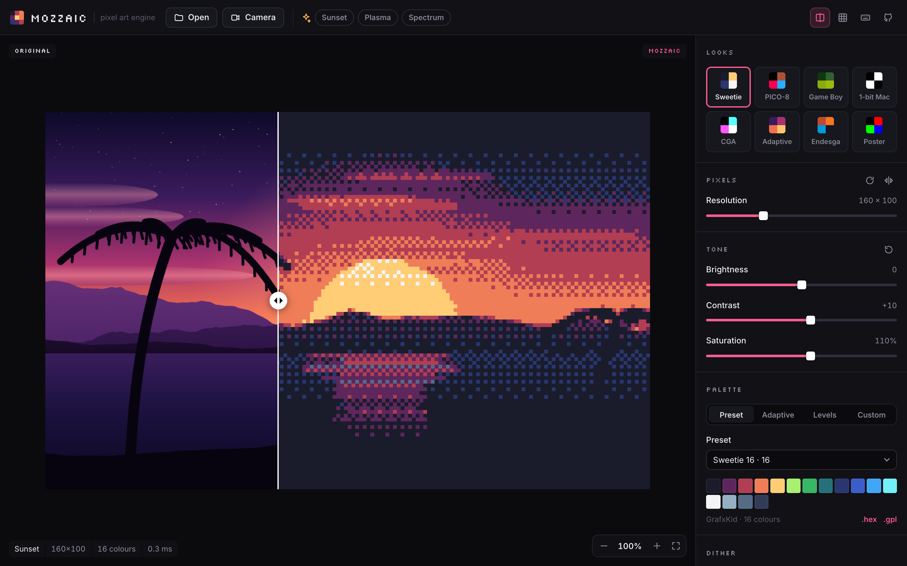

</div>

## Why Mozzaic

Shrinking an image and posterising it gives you mush, not pixel art. Mozzaic treats it as reconstruction:

- **Area-averaged downsampling** so each art pixel is the true average of the area it covers, with no moiré or aliasing.
- **Perceptual colour matching in [Oklab](https://bottosson.github.io/posts/oklab/)**, so "nearest colour" means nearest to your eye, not nearest in RGB maths.
- **Real palettes** (PICO-8, Game Boy, Sweetie 16, Endesga 32, CGA…), an adaptive k-means palette, or your own `.hex` / `.gpl`.
- **Eight dither modes**: ordered Bayer and noise run on the GPU, and Floyd–Steinberg, Atkinson and Sierra error diffusion run on the CPU.
- **Stable video.** The optional Python backend renders whole clips with one fixed palette and optical-flow smoothing, so colours don't "boil" from frame to frame.

Everything in the web app runs locally on your device. Files are never uploaded unless you choose a server render.

## Features

| | |
|---|---|
| **Sources** | Images, videos, your webcam, paste from clipboard, drag & drop anywhere, three built-in samples (one animated) |
| **Pixels** | Output resolution from 16 to 512 art pixels wide, rotate, mirror |
| **Tone** | Brightness, contrast and saturation, applied before quantisation |
| **Palettes** | 10 presets · adaptive k-means (2–32 colours) · levels per channel · custom import (`.hex`, `.gpl`, any text with hex codes) · export as `.hex` / `.gpl` · click a swatch to copy it |
| **Dithering** | None · Bayer 2×2 / 4×4 / 8×8 · interleaved-gradient noise · Floyd–Steinberg · Atkinson · Sierra Lite, all with adjustable strength |
| **Viewer** | Scroll to zoom around the cursor, drag to pan, before/after split, pixel grid, transparent-pixel checkerboard |
| **Export** | PNG at 1–16× nearest-neighbour scale, copy to clipboard, WebM recording (one full loop for videos) |
| **Video** | Optional FastAPI backend: fixed palette + optical-flow stabilised MP4 render, with upload progress |
| **Quality of life** | 8 one-click looks, keyboard shortcuts, settings saved per browser, responsive down to phone width |

### Looks

Exports straight from the app: same 160×100 sunset, different look.

| Sweetie 16 · Bayer | PICO-8 · Bayer | Game Boy · Bayer |
|---|---|---|
| 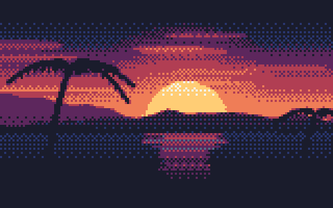 | 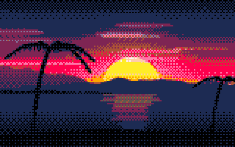 | 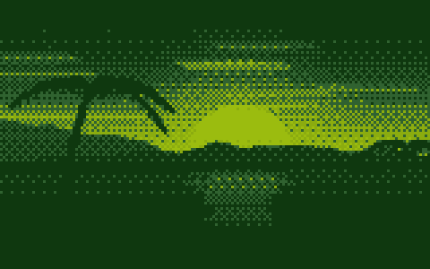 |
| **1-bit · Atkinson** | **Endesga 32 · Noise** | **Vapor · Bayer 8×8** |
| 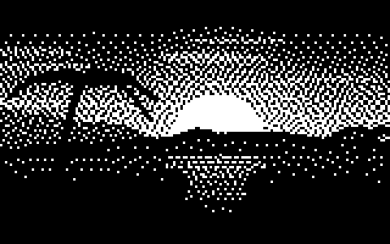 | 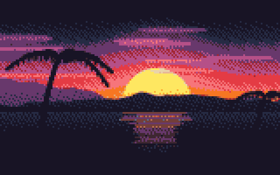 | 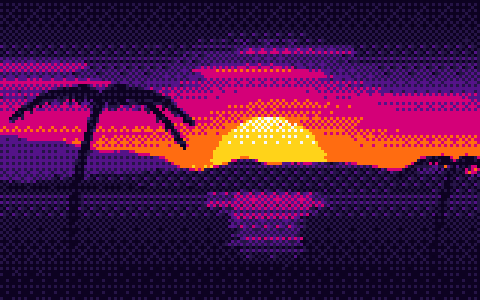 |

### Dither modes

Game Boy palette, 120 px wide.

| None | Bayer 4×4 | Noise | Floyd–Steinberg | Atkinson |
|---|---|---|---|---|
| 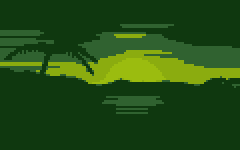 |  | 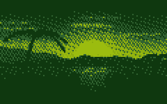 | 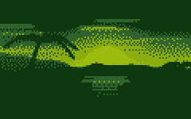 | 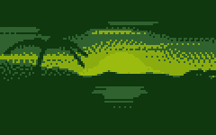 |

### More screenshots

| Zoom, grid & adaptive palette | Video with server render | Phone layout |
|---|---|---|
| 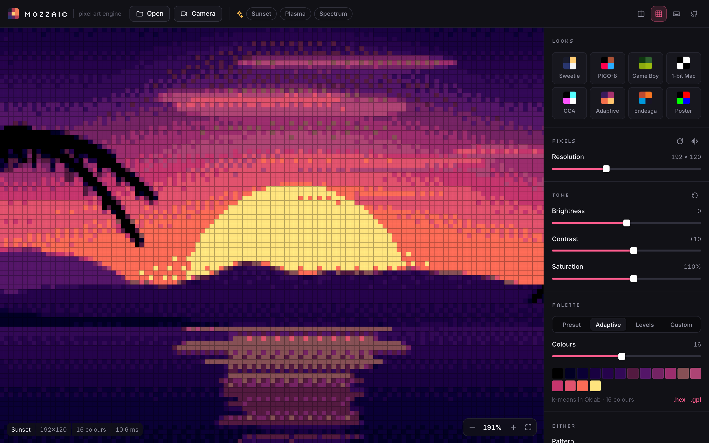 | 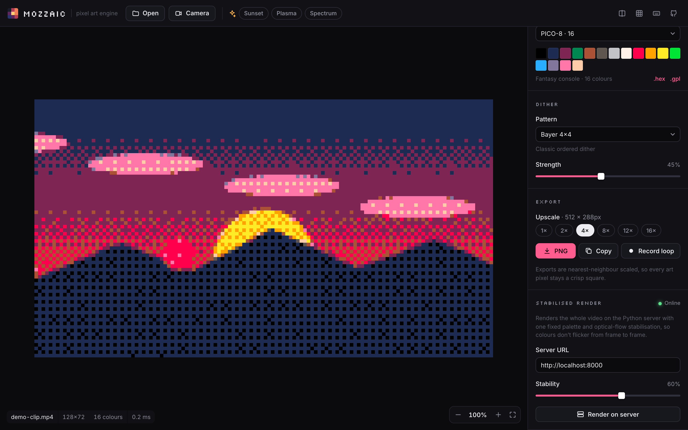 | 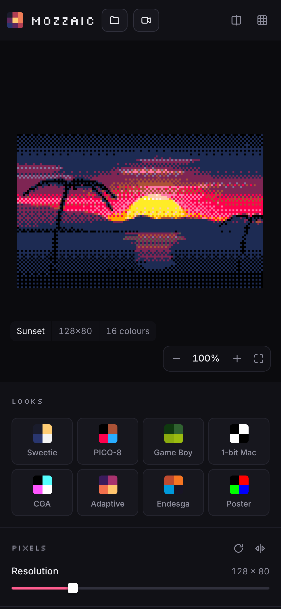 |

## Quick start

### Web app

Requires Node 20.19+.

```bash
cd client
npm install
npm run dev
```

Open [http://localhost:5173](http://localhost:5173). That's all you need for images, webcam, recording and PNG export.

### Backend (optional, for stabilised video)

Requires Python 3.11+. Run it from the **repository root** so `server` imports as a package.

```bash
python3 -m venv server/.venv
source server/.venv/bin/activate
pip install -r server/requirements.txt
uvicorn server.main:app --reload
```

Load a video in the web app and the **Stabilised render** panel will find the server at `http://localhost:8000` (the URL is editable). The server also answers Private Network Access preflights, so browsers that allow it can reach a local server from the hosted app too. Interactive API docs live at [http://localhost:8000/docs](http://localhost:8000/docs).

## How it works

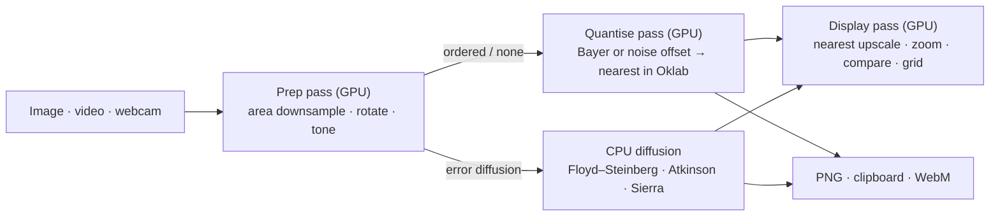

1. **Prep** renders the source into a texture exactly the size of the pixel art. Each art pixel averages a 4×4 grid of samples taken from the right mip level, so a 4K photo and a 320 px GIF both reduce cleanly. Rotation, mirroring and tone happen here too.
2. **Quantise** maps every art pixel to the closest palette colour in Oklab. Ordered dithering nudges the colour by a Bayer threshold, computed recursively for 2×2, 4×4 or 8×8, or by interleaved-gradient noise before matching. Error diffusion runs on the CPU instead. Its error is spread in an Oklab-based space and clamped to the palette's range, so colours the palette can't reach don't smear across the image.
3. **Display** upscales with nearest-neighbour sampling only, snapped to whole device pixels so every block stays square.

The **video backend** fixes one palette for the whole clip (given, or k-means over frames sampled across it). For each frame it warps the previous result along dense Farneback optical flow and blends it with the new frame wherever the warp agrees with the image. That averages away sensor noise *along* the motion. Without dithering, palette indices also get hysteresis: a pixel keeps its colour unless the new one is clearly better. Occluded and revealed regions always use the fresh frame, and the output only ever contains palette colours.

On a noisy test clip, the share of pixels that change colour between frames drops like this:

| Stability | 0 (frame-by-frame) | 0.3 | 0.6 (default) | 0.9 |
|---|---|---|---|---|
| No dither | 7.9 % | 1.5 % | **0.47 %** | 0.40 % |
| Bayer 4×4 | 7.9 % | 5.6 % | **3.6 %** | 2.1 % |

More detail in the [technical guide](docs/GUIDE.md).

## API

| Endpoint | What it does |
|---|---|
| `GET /health` | `{"status": "ok", "version": "2.0.0"}` |
| `GET /palettes` | Built-in palettes as hex lists |
| `POST /palette?colors=8` | Suggest a palette for an uploaded image (k-means in CIELAB) |
| `POST /process/image` | Pixelate an image → PNG. Query: `width`, `palette` (preset id or `hex,hex,…`), `colors`, `dither` (`none` · `bayer4` · `floyd`), `strength`, `scale` |
| `POST /process/video` | Stabilised video → MP4 (H.264 when available). Query: `width`, `palette`, `colors`, `dither` (`none` · `bayer4`), `stability` 0–1, `scale`, `max_frames` |

```bash
curl -F file=@clip.mp4 "http://localhost:8000/process/video?width=160&palette=pico-8&stability=0.6" -o clip-pixel.mp4
```

Uploads are streamed to a private temp folder under a server-chosen name and deleted after the response. Size is capped by `MOZZAIC_MAX_UPLOAD_MB` (default 200), and allowed browser origins by `MOZZAIC_CORS_ORIGINS` (default `*`).

## Keyboard shortcuts

| Key | Action | Key | Action |
|---|---|---|---|
| `O` | Open a file | `R` | Rotate 90° |
| `E` | Export PNG | `F` | Fit to screen |
| `C` | Before / after | `[` `]` | Resolution − / + |
| `G` | Pixel grid | `1`–`8` | Apply a look |
| `?` | Show shortcuts | | |

## Project layout

```
client/                 React 19 + TypeScript + Vite web app
  src/lib/renderer.ts     WebGL2 three-pass pipeline
  src/shaders/            prep · quantize · display GLSL
  src/lib/dither.ts       CPU error diffusion
  src/lib/kmeans.ts       adaptive palettes (k-means++ in Oklab)
  src/lib/palettes.ts     built-in palettes
  src/components/         viewport, inspector, export & server panels
server/                 FastAPI + OpenCV backend
  processing.py           resize, palettes, quantisation, dithering
  video.py                optical-flow stabiliser
  main.py                 HTTP API
  tests/                  pytest suite
docs/                   technical guide and screenshots
```

## Development

```bash
# web app
cd client && npm run lint && npm test && npm run build

# backend (from the repo root)
pip install -r server/requirements-dev.txt
python -m pytest server
```

CI runs both on every push and pull request.

**Deploying the web app:** it is a static site. On Vercel, set the project root to `client` (build `npm run build`, output `dist`). Set `VITE_API_URL` if you host the backend somewhere other than `localhost:8000`.

## Browser support

Any browser with WebGL2: current Chrome, Edge, Firefox and Safari (15+). Copying images needs the async Clipboard API. Recording uses `MediaRecorder` (WebM in Chrome and Firefox, MP4 in Safari).

## License

[MIT](LICENSE)
